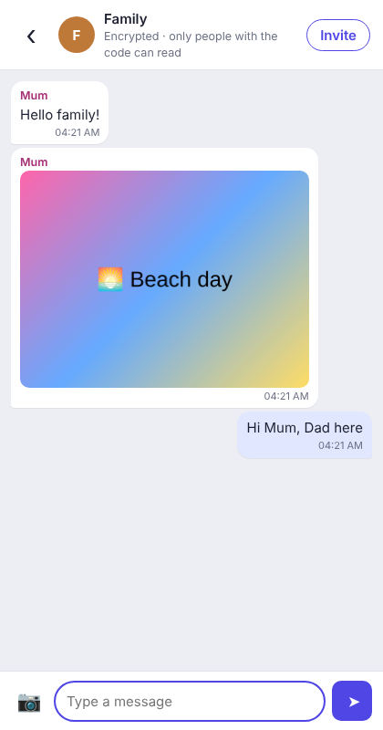

# Pigeon Chat

A simple private chat app for family: text and photos, no accounts, no phone numbers, no setup.

- **Use it online:** https://lamksim.github.io/What/ (try the demo: https://lamksim.github.io/What/?demo)
- **Android app:** https://github.com/lamksim/What/releases/download/android-latest/PigeonChat.apk



## How to use

1. Open the app and type your name.
2. Tap **＋ > Start a chat**, give it a name (e.g. "Family"), then tap **Invite > Share invite** and send it to family.
3. Family install the app, tap **＋ > Join with code**, and type the code (or just open the invite link).

## How it works

- There is no server of our own. Messages travel through free public "Nostr" relay servers (`config.js` lists them). Each message goes to 5 relays, so one being down doesn't matter.
- Every chat has a secret 16-character invite code. The app turns that code into an encryption key, and every message and photo is encrypted (AES-256-GCM) on the phone before it is sent. The relays only see scrambled data.
- Anyone who has the code can read and write in that chat, so only share it with family.
- Each phone also keeps its own copy of the messages, so history stays even if a relay deletes old messages.
- Photos are shrunk to about 40 KB before sending (good for phones, not full quality).
- The open chat checks for new messages every second. There are no push notifications yet.

## Files

| File | What it does |
|---|---|
| `index.html`, `style.css`, `app.js` | The app screens |
| `net.js` | Encryption and sending/receiving through the relays |
| `demo.js` | Pretend chat for the demo |
| `config.js` | App links and the relay list |
| `vendor/` | nostr-tools 2.10.4 (MIT licence) |
| `manifest.webmanifest`, `sw.js`, `icons/` | Make it installable as a phone app |
| `android/` | Small Android app that opens the online app in Chrome |
| `.github/workflows/web.yml` | Publishes the app to GitHub Pages on every push |
| `.github/workflows/android.yml` | Builds the APK when `android/` changes |
| `.github/workflows/relay-check.yml` | Checks weekly that the relays still accept messages |

## Try it on a computer

```bash
python3 -m http.server 8080
```
Then open http://localhost:8080/?demo
