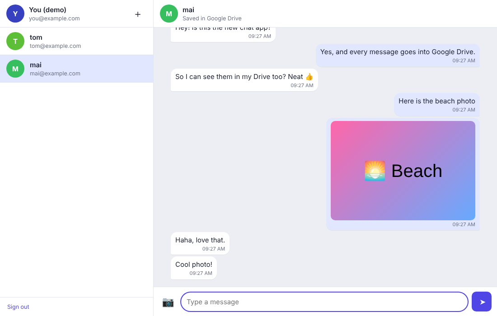

# Pigeon Chat: setup guide

Pigeon Chat is a small 1:1 chat web app. Every message and photo is saved as a file in Google Drive, in a folder shared between the two people chatting.



## 1. Try it without Google (2 minutes)

You need Python (it is already on most Macs and Linux machines).

```bash
cd pigeon-chat
python3 -m http.server 8080
```

Open <http://localhost:8080/?demo>. In demo mode nothing is saved and a pretend friend replies to you.

## 2. Create your Google OAuth Client ID (about 10 minutes, one time)

1. Go to <https://console.cloud.google.com/> and sign in.
2. Top bar, project picker, **New project**. Name it `Pigeon Chat`, then **Create** and select it.
3. **APIs & Services > Library**, search for **Google Drive API**, click **Enable**.
4. **APIs & Services > OAuth consent screen** (may be called **Google Auth Platform > Branding / Audience**):
   - App name `Pigeon Chat`, your email as support and developer contact.
   - User type / Audience: **External**.
   - Leave the publishing status as **Testing**.
   - Under **Test users**, add your Gmail address **and every friend who will use the app** (up to 100).
5. **Data access / Scopes**: add `https://www.googleapis.com/auth/drive`. (This is the full Drive scope. It is needed so your friend can open the chat folder you share with them.)
6. **APIs & Services > Credentials > Create credentials > OAuth client ID**:
   - Application type: **Web application**.
   - **Authorized JavaScript origins**: add `https://lamksim.github.io` (the online app) and `http://localhost:8080` (for testing on a computer).
   - **Authorized redirect URIs**: add `https://lamksim.github.io/What/` and `http://localhost:8080/` (with the slash at the end).
   - Click **Create** and copy the **Client ID** (it ends in `.apps.googleusercontent.com`).
7. Send me the Client ID (it is not a secret) and I'll put it in `config.js`, so your family never has to type it.

## 3. Install on Android (for you and your family)

1. On the phone, open the download link for **PigeonChat.apk** (from the GitHub release page) and download it.
2. Tap the downloaded file. Android asks to allow installing from this source (Chrome or Files): tap **Settings**, turn on **Allow from this source**, go back, and tap **Install**.
3. If Play Protect warns about an unknown app, tap **More details > Install anyway**. This is normal for apps not from the Play Store.
4. Open **Pigeon Chat**, tap **Sign in with Google**, pick your Gmail account.
5. Google shows "Google hasn't verified this app". Tap **Continue**, and **tick the box to allow Google Drive access**.

On iPhone (or instead of the APK on Android), open the app's web link in the browser and choose **Add to Home Screen**.

## 4. Chat

1. Tap **＋** and enter a family member's Gmail address. They get a Drive share email.
2. Send messages or photos with 📷.
3. The family member opens the app, signs in, and the chat appears in their list.

Everyone must be added as a **test user** in step 2.4, or Google won't let them sign in.

## What it looks like in Drive

```
My Drive/
  Pigeon Chat/
    Chat: you@gmail.com & friend@gmail.com/   <- shared with your friend
      msg-2026-11-21T09-30-00-000Z.json        <- one file per text message
      photo-2026-11-21T09-31-12-000Z-cat.jpg   <- photos stored as normal images
```

Each message is its own file, so two people writing at once never overwrite each other. Text is also copied into the file's description so the app can show a whole chat with one request.

## How it works (and current limits)

- **No server.** It is plain HTML/JS. The browser talks directly to the Google Drive API with your Google sign-in.
- **New messages arrive by checking Drive every 4 seconds** (change `pollSeconds` in `config.js`). It is not instant push like big chat apps.
- **1:1 chats only**, text and photos. No group chats, read receipts, typing indicators or notifications yet.
- Opening a chat loads the latest 100 messages.
- Sign-in lasts about an hour; after that the app briefly goes to Google and comes back to renew it.
- Testing mode allows up to 100 test users. Going public would need Google's verification for the Drive scope.
- Each person's messages use their own Drive storage quota.

## Files

| File | What it does |
|---|---|
| `index.html` | Page layout |
| `style.css` | Look and phone layout |
| `app.js` | Chat list, chat screen, sending, polling |
| `drive.js` | Google sign-in and Drive storage |
| `demo.js` | Fake in-memory storage for the demo |
| `config.js` | Your Client ID and polling interval |
| `manifest.webmanifest`, `sw.js`, `icons/` | Make it installable as a phone app |
| `android/` | Small Android app that opens Pigeon Chat in Chrome (built by GitHub) |
| `.github/workflows/build.yml` | Publishes the web app and builds the APK on every push |
